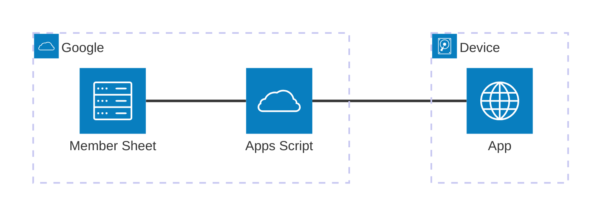
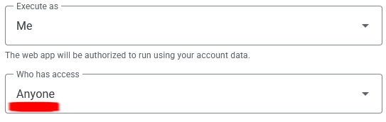

# Architecture

Why the app is shaped the way it is, and the contract between the app and the
service that reads the member sheet. `README.md` covers running and publishing;
`HANDOVER.md` is the operational note.

## Overview

Three parts: a client-side web app served from GitHub Pages, a Google Apps
Script running in Google's cloud, and a Google Sheet in the society's Drive.



The app stores the member list on the device and reads the sheet only to fetch
the latest data. It is a single-page PWA; the expected usage is installed on a
phone and used like a native app. Installation is covered in
[`README.md`](README.md).

## Why Apps Script

The app cannot sign in to Google, so it cannot read a private sheet directly.
The Apps Script runs as the sheet's owner and returns only the fields the app
needs, so the sheet itself stays private.

Google sign-in in the app would add significant complexity and require the
society to maintain a Google Cloud project. Apps Script is free and, once set
up, needs little maintenance. It is also the only way for a client-side
application to read a sheet without making the sheet public.

## What is public

The script deployment accepts anonymous calls, and its URL is in the app's
published code. Anyone who reads that code can fetch the member list.

**Public:** student number, name, membership and paid status for every member.
The application code and the Apps Script source are also public.

**Not public:** the sheet itself and every other column. The reply is assembled
field by field in `members.gs` and contains nothing else; unused columns never
leave Google.

**The passcode does not protect any of this.** It is a deterrent, not a security
measure, and is easily bypassed. Its only purpose is to stop a passer-by from
opening the app.

## Deployment settings

| Setting        | Value      | In `appsscript.json` | Why                                                |
| -------------- | ---------- | -------------------- | -------------------------------------------------- |
| Execute as     | **Me**     | `USER_DEPLOYING`     | Owner's access, so the sheet stays private         |
| Who has access | **Anyone** | `ANYONE_ANONYMOUS`   | The app cannot sign in, so calls must be anonymous |



"Anyone **with a Google account**" (`ANYONE`) is a different setting and does
not work: it requires the caller to be signed in. "Anyone" is the only setting
that allows anonymous calls.

The sheet to read comes from a script property, not from the request. See
`HANDOVER.md`.

## Data source contract

`src/lib/members.ts` fetches one address, taken from one setting, and validates
the reply. **Any source that replies in this shape works**; the Apps Script is
one implementation, not a dependency.

```jsonc
{
  "sheetName": "MBLDS Members 2026", // shown on the settings screen
  "members": [
    {
      "studentId": "27168182", // 8 digits, not starting with zero
      "name": "Test User", // may be empty
      "membership": "University", // may be empty; NOT about payment
      "paid": true, // true | false | null - parsed from the Paid column; null means unrecognised
      "paidRaw": "y", // the column's raw value
    },
  ],
  "concerns": [
    {
      "message": "3 rows were skipped for having no 8-digit student number.",
      "hint": "A few are expected...", // optional
      "examples": ["000000116"], // optional
    },
  ],
}
```

The app only checks the reply's shape. A replacement source must therefore
guarantee all of it: `sheetName` a non-empty string, every member carrying all
five fields with the types above, and `concerns` an array.

The exception is the contents of `concerns`. Nothing is decided from them, so
entries the app cannot parse are dropped and the list is still used. Discarding
a member list over an advisory would defeat the purpose of the advisory.

Easy to get wrong:

- `paid` is three-valued. `null` means the column held something unrecognised;
  the app shows it as unclear rather than unpaid, and displays `paidRaw`.
- `membership` is affiliation, not payment.
- Failures are returned as `{ "error": "..." }` with HTTP 200.
- `concerns` are advisory and must stay that way. They are counted behind a
  disclosure on the settings screen and never block anything.

The app stores the reply on the device under a version number
(`STORED_VERSION` in `lib/members.ts`). **Bump it in the same change as any
change to the stored shape.**

## Upgrading to a permanent server

A small server with a Google service account would address several limitations
of this setup.

Pros:

- The member list can stay private, because the server can sign in to read it.
- The server can write back to the sheet, so the app could record attendance.
- The server can implement real access control, so the app could have a proper
  login and the passcode could be removed.
- Simpler handover.

Cons:

- The society must maintain a Google Cloud project and service account.
- The server must be hosted, which is another account to manage.
- Free-tier compute is limited, and misuse or misconfiguration can lead to
  large bills.
- Some providers prune free-tier projects, so it needs monitoring to avoid
  deletion.

### Suggested implementation

- Create a service account in a Google Cloud project. It gets its own address,
  like `scanner@…iam.gserviceaccount.com`.
- Share the member sheet with that address as Viewer. Nothing else about the
  sheet changes, and it stays private.
- One endpoint, `GET /members`, returning the shape above. The sheet-reading
  logic ports almost directly from `members.gs`.
- Keep the service-account key in an environment variable on the host, never in
  the repository.
- Cache for a few minutes, so a door with ten phones causes one read of the
  sheet.
- Point `VITE_MEMBER_LIST_URL` at it. No other change to the app.

The suggested host is
[Cloudflare Workers](https://www.cloudflare.com/products/workers/): it is
[free at this scale](https://www.cloudflare.com/products/workers/#workers-pricing)
and supports storing the key as a secret environment variable. The worker would
read the sheet through the Google Sheets REST API. It can be deployed from this
repository, with the existing workflow extended to deploy it on every push to
`main`.

The app could then also move to Cloudflare Pages, which deploys from GitHub for
free. Serving the app and the server from the same domain avoids CORS.

If the free tier proves insufficient, the paid tier is US$5/month (about
R85/month) with a generous included allowance.
