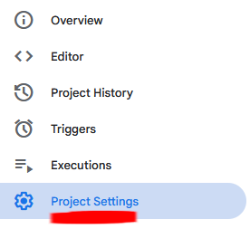
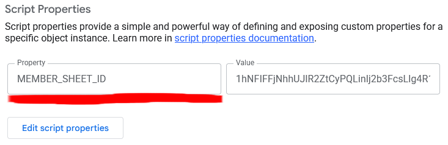
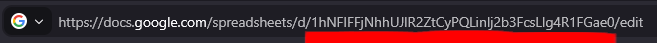
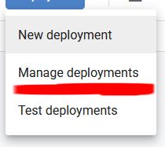
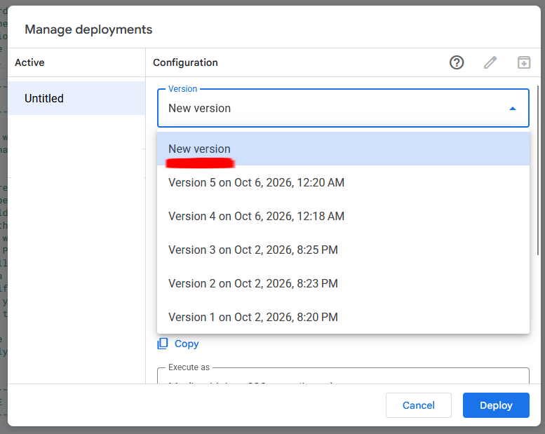

# Handover

What is needed to keep the Membership Scanner working. If you read only one
file, read this one.

## The one job each year

When the committee creates a new member sheet, the app has to be pointed at it.
This is the whole job, and takes about a minute:

1. Open <https://script.google.com> signed in as the **society's** Google
   account.
2. Open the project called **Membership Scanner member list**.
3. Click **Project Settings** (the gear on the left). 

4. Under **Script Properties**, find `MEMBER_SHEET_ID` and click "Edit
   script properties".

5. Open the new member sheet in Google Sheets and look at its address. Copy the
   long code between `/d/` and `/edit`, without the `/`s and without the rest
   of the address.

6. Paste it in as the value and click **Save script properties**.

The script can take up to five minutes to start reading the new sheet, so wait
that long before testing.

To confirm the new sheet is being read, open the app, go to
**Settings › Member list** and click **Refresh**. Check that:

- the sheet name is correct
- the number of members is about right

Or use **View list** and check that the first few members are correct.

**Then refresh every phone used at the door**, the same way. Each phone keeps
its own saved copy of the list and only asks for a new one once that copy is a
week old. Until it is refreshed, a phone keeps checking cards against last
year's members, and new members show as not on the list.

## Where the app lives

The app's address is `https://mdssup.github.io/`.

The easiest way to give it to a new volunteer is from a phone that already has
it: **Settings › Share this app › Show QR code**, and they scan it with their
camera. The app then walks them through adding it to the home screen, and they
need the passcode.

If you send the link instead, tell them to open it in **Safari** on an iPhone
or **Chrome** on Android. A link tapped inside WhatsApp, Instagram or a similar
app opens in that app's own browser, which can't add the app to the home screen
and may not be allowed the camera.

If the address ever changes, see "Setting it up from nothing" in
[`README.md`](README.md).

## Who to ask

The app tells people to ask "the IT manager" for the passcode and for help. If
the society would rather show a person's name or a contact address, change
`ADMIN_NAME` in `src/config.ts`, and keep it up to date when the committee
changes. Editing it on GitHub republishes the app; see "Setting it up from
nothing" in `README.md` for how to edit a file there.

## What the sheet needs

The script that reads the sheet tolerates a lot of variation. The only
requirements are:

- At least one tab of member data, with:
  - a column headed something like "Student Number" or "Student ID"
  - a column headed something like "Paid"
- A row is used only if it has a student number. A missing or unrecognised
  payment status is reported, not interpreted.

Optional columns:

- first name, last name, full name, or a combination (the script looks for
  whichever are present)
- membership type (e.g. "University", "Non-student")

The accepted headings are deliberately broad. If unsure, compare the sheet's
headings with the patterns in `apps-script/members.gs`.

## Who must own what

All four of these must belong to the **society**, not to a person. If any of
them is on a personal account, the app stops working when that person loses the
account.

- the Google account that owns the member sheet
- the Apps Script project (above)
- the GitHub account the app is published from
- the member sheet itself

## Changing the passcode

The app asks for a shared passcode once per device. It keeps strangers out of
the app; it is **not** a security measure, and it does not protect the member
list. To change it, edit `PASSCODE_HASH` in `src/config.ts` on GitHub. That
file explains how to turn a passcode into the code it needs, including a way
that needs only a browser. Saving the change republishes the app.

Once it changes, every device asks for the new passcode.

## Three things not to do

1. **Don't use "New deployment" when editing the script.** Use **Deploy › Manage
   deployments › the pencil › New version**. "New deployment" creates a second
   address, and the app keeps using the old one, so the change appears to do
   nothing.

2. **Don't move the script inside the spreadsheet.** It must remain a separate
   project. A script inside a sheet is copied when the sheet is duplicated, and
   the copy doesn't work, so the app would silently keep reading last year's
   members.
3. **Don't let the script accept a sheet ID from the web address.** Anyone can
   call it, so this would let anyone read any sheet the society's account can
   open.

## When something goes wrong

Start with the app's help, under the **?** button on the main screen. It covers
the common problems.
