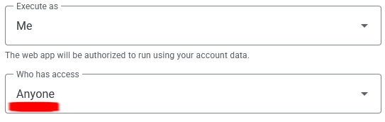
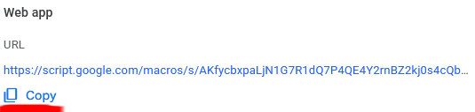

# Membership Scanner

A phone web app for the society's door desk. It reads the barcode on a student
card and shows whether that person is on the member list and whether they have
paid.

## Documents

| File                                     | Purpose                                                       |
| ---------------------------------------- | ------------------------------------------------------------- |
| [**`README.md`**](README.md)             | This file. Installation, setup, publishing and development.   |
| [**`HANDOVER.md`**](HANDOVER.md)         | Yearly maintenance: pointing the app at a new member sheet.   |
| [**`ARCHITECTURE.md`**](ARCHITECTURE.md) | Design rationale, data flow, and the data source contract.    |

## Installation

The app is a PWA. Open its address in a browser and add it to the home screen;
this is the intended way to use it. In a browser tab the app asks for this
before anything else, and can be told to carry on in the browser for that tab.

- **iOS:** **Share > Add to Home Screen**, with "Open as web app" switched on.
- **Android:** **Menu > Add to Home Screen** or **Menu > Install app**.

For other platforms or installation problems, see
[web.dev: PWA installation](https://web.dev/learn/pwa/installation).

## Setting up the member list service

The app fetches the member list from a Google Apps Script web app, which reads
the member sheet and returns only the fields the app uses. The script is
[`apps-script/members.gs`](apps-script/members.gs). The copy in this repository
and the copy in the Google project are not synced automatically; keep them the
same by hand.

[`ARCHITECTURE.md`](ARCHITECTURE.md) explains why it works this way.

Do all of this signed in as the **society's** Google account, not a personal
one, so it survives a change of committee.

**These steps are for first-time setup only. To change the sheet being read,
follow [`HANDOVER.md`](HANDOVER.md) instead.**

1. At `script.google.com`, create a **new standalone project** (not one created
   from inside the spreadsheet).
2. Paste in the contents of `apps-script/members.gs` and save.
3. **Project Settings → Script Properties → Add script property.** Name it
   `MEMBER_SHEET_ID` and set it to the sheet's ID: the part of the sheet's
   address between `/d/` and `/edit`.
4. **Deploy → New deployment → Web app**, with _Execute as:_ **Me** and _Who has
   access:_ **Anyone**. Authorise it when asked, and copy the `.../exec` address.

   
   

5. In the GitHub repository, open **Settings › Secrets and variables › Actions
   › Variables** and set `MEMBER_LIST_URL` to that address. It is kept there
   rather than in the code so that GitHub's search can't find it; the comment
   on `MEMBER_LIST_URL` in `src/config.ts` explains.
6. Publish again: **Actions › Publish › Run workflow**. Changing a variable
   does not publish by itself.

To test the script, open its `.../exec` address in a browser. It should return
a JSON object containing the member list.

### Deploying from Firefox

Some browsers, Firefox in particular, interfere with Google authentication
during deployment when tracking protection is on. Use a different browser, or
disable tracking protection for `script.google.com` and
`script.googleusercontent.com`.

## Publishing

The app is served from the root of the society's GitHub Pages site, at
`https://mdssup.github.io/`.

The workflow in [`.github/workflows/publish.yml`](.github/workflows/publish.yml)
builds and publishes the app on every change to `main`. Routine changes need
nothing else. The version in `package.json` is shown in the app, but publishing
doesn't need it changed; the commit shown next to it identifies each build.

To publish again without changing anything, open the repository's **Actions**
tab, choose **Publish**, then **Run workflow**.

If a publish fails with a message about a deprecated or retired action, GitHub
has retired an old version of one of the steps the workflow uses. Raise the
number after `@` on the step it names in `.github/workflows/publish.yml` (for
example `@v4` to `@v5`); each step's GitHub page lists its current version.

### Setting it up from nothing

All of this is done on github.com in a browser. Nothing needs installing.

1. Sign in to GitHub as the **society's** account.
2. Get the code into a repository named exactly `mdssup.github.io`.
   The name matters: any other name puts the app in a sub-folder of the site,
   where it does not work (see the note on `base` in `vite.config.ts`). The
   repository must be **public**, because free accounts can only publish public
   repositories.
   - **Moving from another account:** in the old repository, **Settings ›
     General › Transfer ownership**, then rename it in **Settings › General**.
   - **Starting from a copy of the code:** create the repository, then **Add
     file › Upload files** and drag in everything except `node_modules` and
     `dist`. Check the upload included the `.github` folder; the dot hides it
     on most computers. If it is missing, use **Add file › Create new file**,
     name it `.github/workflows/publish.yml`, and paste the file's contents in.
3. **Settings › Pages › Build and deployment › Source:** choose **GitHub
   Actions**.
4. Set the `MEMBER_LIST_URL` variable, as in steps 5 and 6 of setting up the
   member list service (above). If that service doesn't exist yet, set it up
   first.
5. Open `src/config.ts` in the repository and press the pencil icon to edit it.
   Check `PASSCODE_HASH` and `ADMIN_NAME`, then press **Commit changes**,
   committing to `main`.
6. Open the **Actions** tab and wait for **Publish** to show a green tick. It
   takes a couple of minutes. If nothing started, run it by hand as described
   above. If it fails saying `MEMBER_LIST_URL` is not set, the variable is
   missing or misspelt.
7. On a phone, open `https://mdssup.github.io/`, unlock it, and press
   **Settings › Member list › Refresh**. Check the sheet name and the number of
   people.

**If the address has changed**, installed copies keep pointing at the old one.
Each phone has to remove the app from its home screen and add it again from the
new address. Update the address in [`HANDOVER.md`](HANDOVER.md) as well.

## Deployment settings

Settings a non-developer is likely to need are in **`src/config.ts`**, each with
a comment explaining it.

Each can be overridden at build time by an environment variable in `.env.local`
or `.env`. See `.env.example` for names and formats.

The exception is the member list's address, which is not written in
`config.ts` at all. Published builds get it from the `MEMBER_LIST_URL` Actions
variable, and development needs `VITE_MEMBER_LIST_URL` in `.env.local`.

## The passcode

The passcode is a deterrent, not a security measure. It stops a passer-by from
opening the app. It does **not** protect the member list: anyone who reads the
app's published code can fetch the list without it. The current passcode hash,
and how to change it, are in `src/config.ts`.

## Development

```sh
pnpm install
pnpm dev
```

| Command        | Does                                                  |
| -------------- | ----------------------------------------------------- |
| `pnpm lint`    | Checks code style.                                    |
| `pnpm build`   | Builds the site into `dist/`.                         |
| `pnpm preview` | Serves the build, for checking it before publishing.  |
| `pnpm icons`   | Regenerates the app's icons.                          |

The camera requires a secure context: `https` or `localhost`. Your own machine
works, but a phone reaching the dev server by its LAN address does not. The
camera won't start, and the passcode screen can't check a passcode.

To test scanning on a phone, run the dev server through a tunnel that gives it
an `https` address. Two options: [ngrok](https://ngrok.com/) or
[Tailscale Serve](https://tailscale.com/docs/features/tailscale-serve). Both
are free for personal use.

On a machine with no camera, add this to `.env.local` to work on everything
except scanning:

```sh
VITE_ALLOW_MISSING_CAMERA=true
```

### Source layout

Code is grouped by purpose. Each screen has a folder holding everything only
that screen uses, so changing one screen means opening one folder. Anything used
in more than one place sits above them.

```none
src/
  main.tsx
  config.ts
  index.css
  app/          app state, screen selection, the error screen
  lib/          data fetching, member list, passcode, errors
  components/   pieces used by more than one screen
  pages/        one folder per screen (scan, settings, member list, log, etc.)
```

Icons come from [Heroicons](https://heroicons.com) via the `@heroicons/react`
package: find one on the site and import it by name.
